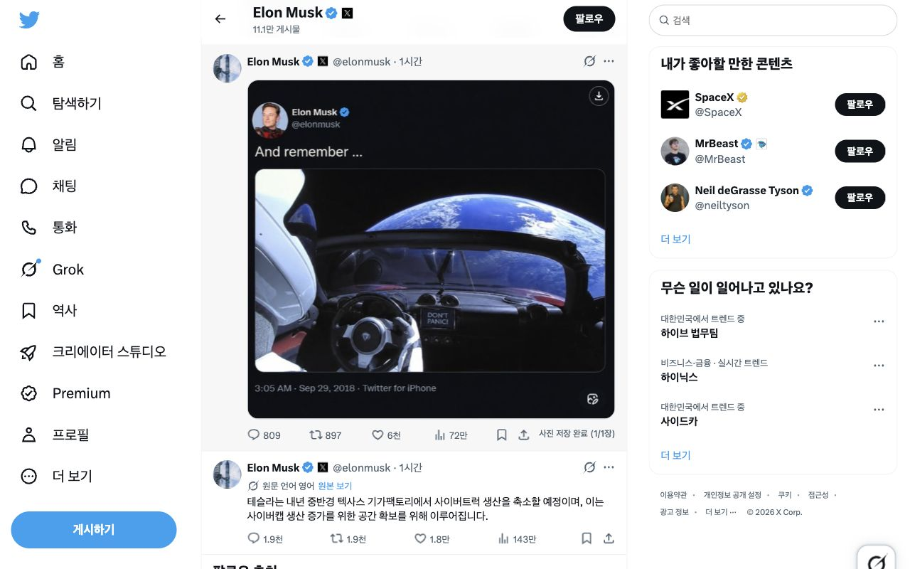

# X 이미지 저장

현재 보고 있는 X 게시물의 정적 사진을 저장하는 Chrome 확장 프로그램입니다. 사진 한 장이나 확인된 첨부 사진 전체를 저장하고, 이미지 크기·저장 폴더·파일명 규칙을 설정할 수 있습니다. 동영상과 애니메이션 GIF 저장은 지원하지 않습니다. X와 제휴·승인 관계가 없는 독립 프로젝트입니다.



## 개발자 설치

Chrome 123 이상이 필요합니다. 소스를 빌드하려면 Node.js 24.x를 사용합니다.

```sh
npm ci
npm run build
```

Chrome에서 `chrome://extensions`를 열고 개발자 모드를 켠 뒤 **압축해제된 확장 프로그램을 로드**를 선택해 `dist/`를 지정합니다. 설치하거나 확장을 다시 로드한 뒤에는 열린 X 탭도 새로고침하세요.

## 소스 구성

- [`src/x`](src/x/)와 [`src/content`](src/content/): X 게시물에서 정적 사진을 찾고 저장 버튼을 표시합니다.
- [`src/core`](src/core/): 설정 검증, 저장 경로와 파일명 구성, 다운로드 계획을 담당합니다.
- [`src/background`](src/background/)와 [`src/platform`](src/platform/): 다운로드 작업과 Chrome 저장소·다운로드 API를 연결합니다.
- [`src/popup`](src/popup/): 다운로드 설정 화면을 구현합니다.

개인정보 처리 방식은 [개인정보 처리 안내](Privacy.md)를 참고하세요. 문의와 버그 제보는 [GitHub Issues](https://github.com/ch4n33/Twitter-download/issues)에서 받습니다.
