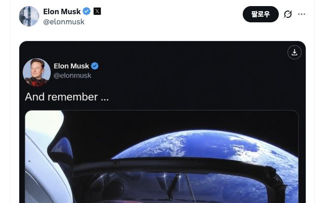

# X 이미지 저장

현재 보고 있는 X 게시물의 사진·동영상·GIF를 저장하는 Chrome 확장 프로그램입니다. `0.3.0`은 GIF 첨부를 브라우저 안에서 실제 `.gif` 파일로 변환해 저장합니다. X와 제휴·승인 관계가 없는 독립 프로젝트입니다.

## GIF 저장 형식

설정창의 **GIF를 .gif 형식으로 저장**은 기본으로 켜져 있습니다. 기존 설정에 이 항목이 없으면 켜진 상태로 불러오며, 사용자가 끈 설정과 나머지 저장 규칙은 유지합니다. 끄면 X가 제공한 MP4를 그대로 저장합니다. 일반 동영상에는 영향을 주지 않습니다.

변환은 숨겨진 확장 문서와 Worker에서 한 번에 하나씩 처리합니다. 팝업을 닫아도 계속되며, `GIF 변환 중 → 파일 저장 중 → 완료` 순서로 표시합니다. 원본 MP4의 해상도와 프레임을 유지하고, 프레임 시간은 GIF의 10ms 단위에 맞춰 누적 반올림합니다. GIF는 반복 재생됩니다. 최대 256색 팔레트 특성상 색상이 달라지거나 파일이 커질 수 있습니다. 변환 실패를 MP4 저장 성공으로 바꾸지 않습니다. 실패한 경우 옵션을 끄고 MP4로 다시 저장할 수 있습니다.

변환 한도는 입력 32 MiB, 60초, 한 프레임 4,194,304픽셀, 전체 3억 픽셀, 출력 64 MiB, 변환 시간 120초입니다. 한도를 넘으면 명확한 오류를 표시하며 해상도·재생 길이를 임의로 줄이지 않습니다. 추가 권한은 `offscreen`과 `https://video.twimg.com/*`에 한정됩니다. 파일 변환에 필요한 코드는 모두 설치 패키지에 포함되며 외부 변환 서버를 쓰지 않습니다.

## 0.2.0 미디어 저장 PoC

- 사진·동영상·GIF를 개별 저장하고, 첨부 목록이 모두 확인된 게시물은 함께 저장합니다. 미확인 항목이 있으면 전체 저장을 막아 누락을 완료로 표시하지 않습니다.
- 영상과 GIF 입력은 제공된 직접 MP4 후보 중 가장 높은 비트레이트를 선택합니다. GIF 출력 옵션을 끄면 해당 MP4를 그대로 저장합니다. 사진 원본 크기 설정은 영상 화질에 영향을 주지 않습니다. HLS 전용 영상과 라이브는 지원하지 않습니다.
- X 페이지가 이미 받은 게시물 응답에서 미디어 정보만 추출합니다. API 키·별도 서버·추가 호스트 권한 없이 동작하며, 확인하지 못한 주소를 추측하거나 포스터로 대체하지 않습니다.
- 완료 문구는 2초 후 숨기고, 체크와 작은 다운로드 화살표를 합친 아이콘을 남깁니다. 성공한 항목만 표시하며 재저장할 수 있습니다. 표시는 현재 페이지 메모리의 최근 게시물 200개 범위에서 유지되고 새로고침하면 초기화됩니다.

확장을 다시 로드한 뒤 X 탭을 새로고침해야 새 미디어 응답을 수집할 수 있습니다. 재생 가능한 모든 영상의 다운로드를 보장하는 범위는 아닙니다. 실제 X 화면과 응답 형식이 바뀌면 주소 해석을 갱신해야 할 수 있습니다.



## 개발자 설치

Chrome 123 이상이 필요합니다. 소스를 빌드하려면 Node.js 24.x를 사용합니다.

```sh
npm ci
npm run build
```

Chrome에서 `chrome://extensions`를 열고 개발자 모드를 켠 뒤 **압축해제된 확장 프로그램을 로드**를 선택해 `dist/`를 지정합니다. 설치하거나 확장을 다시 로드한 뒤에는 열린 X 탭도 새로고침하세요.

## 소스 구성

- [`src/x`](src/x/)와 [`src/content`](src/content/): X 게시물에서 정적 사진을 찾고 저장 버튼을 표시합니다.
- [`src/core`](src/core/): 설정 검증, 저장 경로와 파일명 구성, 다운로드 계획을 담당합니다.
- [`src/background`](src/background/)와 [`src/platform`](src/platform/): 다운로드 작업과 Chrome 저장소·다운로드 API를 연결합니다.
- [`src/popup`](src/popup/): 다운로드 설정 화면을 구현합니다.

개인정보 처리 방식은 [개인정보 처리 안내](Privacy.md)를 참고하세요. 문의와 버그 제보는 [GitHub Issues](https://github.com/ch4n33/Twitter-download/issues)에서 받습니다.

완료 아이콘은 Google Material Symbols의 `download`, `download_done`을 수정해 사용합니다. GIF 변환에는 MP4Box.js와 gifenc를 사용합니다. 출처·수정 내용과 라이선스는 [제삼자 고지](THIRD_PARTY_NOTICES.txt)와 `licenses/`에 있습니다.

## GIF 변환 검증

`npm run check`로 타입·회귀 테스트·빌드를 검사합니다. Firefox, FFmpeg, ffprobe가 설치된 macOS에서는 `npm run verify:gif`로 로컬 MP4 샘플을 실제 브라우저 Worker에서 GIF로 변환하고 프레임 수·크기·길이·반복 재생을 검사합니다. Firefox는 새 임시 프로필을 사용하고 종료 시 정리합니다. 다른 설치 경로는 `GIF_POC_FIREFOX_BIN`으로 지정할 수 있습니다. 검증 GIF와 결과는 `release/gif-poc/`에 남깁니다. 이 검사는 실제 X 탭이나 사용자의 브라우저 프로필을 조회하지 않습니다.
